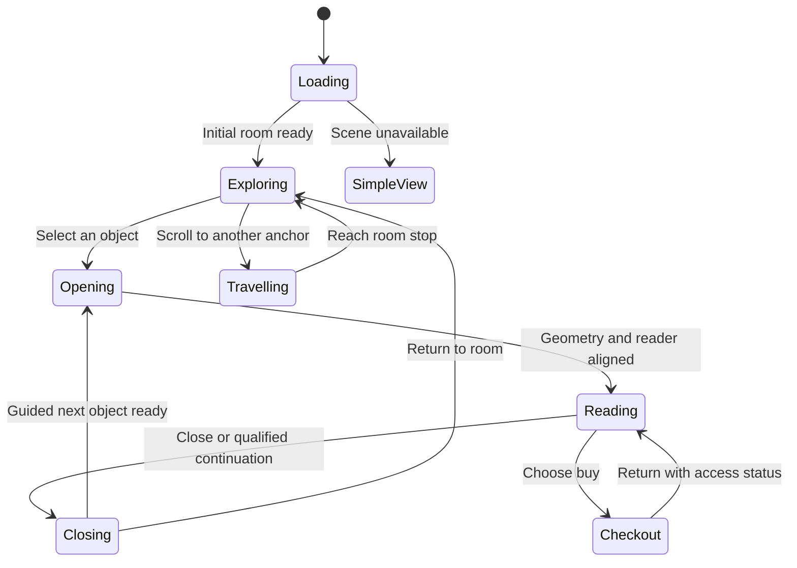

# Donte Miller — Immersive home website build plan

October 27, 2026 · Implementation specification and research

## 1. Intended result

Build a personal website experienced as a continuous visit through Donte's house. Scrolling moves the visitor through a living room, through an arch into a dining room, up to its table, past a workshop wall, and into a library. Selecting meaningful objects brings them forward and opens the corresponding website content. Finishing a reading section and continuing downward can return the object and open the next one.

The supplied images establish the target compositions, colors, furnishings, and painted character. The actual production environment will use connected 3D geometry, textured to match that character, with separately animated objects and readable web content integrated into their opening transitions.

Confirmed commercial model: Flourish Fellowship, AI, and Blockchain are separately purchased curricula, delivered as written lessons with downloadable resources. Each released curriculum has a free first chapter. Cooperatives, Finance, and Funds appear as coming soon until ready. Prices and access duration remain undecided.

### Recommended foundation

**Blender → glTF/GLB → Three.js / React Three Fiber → GSAP timelines and ScrollTrigger → XState interaction states → readable routed pages.**

Use a persistent house canvas alongside conventional HTML content, with shared visual styling and coordinated transitions. Proposed application framework: Next.js with TypeScript. Proposed accounts, purchase records, and private resource storage: Supabase. Proposed payment provider: Stripe Checkout. These are implementation recommendations, not purchased services or configured accounts.

The most valuable first build is one complete experience: **table → select magazine → open press page → read → continue downward → return magazine → open report.** Prove that interaction with a simple room before polishing the entire house.

## 2. How the supplied images become the house

The supplied reference images have been copied unchanged into `reference-images/`. Their original paths, dimensions, sizes, and checksums are recorded in [reference-manifest.csv](reference-manifest.csv). A visual shot-by-shot companion is in [camera-storyboard.md](camera-storyboard.md).

| Reference | Intended role | Production implications |
| --- | --- | --- |
| [Living Room](reference-images/living-room.png) | Opening portrait, couch, lamps, and plaques | Match the frontal composition; make portrait and recognition separate selectable objects. |
| [Transition to dining room](reference-images/living-to-dining.png) | Wider room view and right-hand arch | Establish the physical connection and camera clearance between rooms. |
| [Dining Room](reference-images/dining-room.png) | Frontal arrival, indigo mural, lantern, table | Keep mural, lantern, furniture, rugs, and plants consistent with the transition view. |
| [Dining Room Table](reference-images/dining-table.png) | Near-overhead interaction position | Recreate the oval indigo table and make all three publications independent objects. |
| [Library](reference-images/library.png) | Library arrival and shelves | Preserve painted books, greenery, indigo wall, warm shelves, and rug; reserve a legible shelf for six course titles. |
| [Workshop reference](reference-images/workshop.png) | New intermediate stop at the blue wall before the shelves | This is a reference for the **room**, not a single painting. Model the desk, chair, computer and visible decor as separate 3D objects; build the blue wall and cream surround in geometry. Only the framed painting within the image should use a crop from the supplied artwork as a wall texture. |

The references are flat images, not a measured multi-camera reconstruction. They do not supply hidden room surfaces, a floor plan, material maps, book backs, or hinges. Match the intended views through modeling and texturing; author the connecting space deliberately. The library doorway's location is not shown and needs a designed connection.

The first living-room image contains the personalized portrait and plaque wording; the wider transition view has more generic wall art. Use the personalized wall consistently in the actual model. The dining-room reference covers say KINFOLK and CEREAL; use their placement and proportions as composition references, with a Donte press magazine and a real ten-year-report cover replacing those placeholders.

### Choice of production method

| Method | What it offers | Fit for this project |
| --- | --- | --- |
| Connected 3D rooms with painted textures and selected projected artwork | Real depth, arches, camera travel, moving books, adjustable framing | **Recommended.** Supports the full requested behavior. |
| Layered 2.5D images with foreground objects | Close fidelity near original image angles and smaller initial modeling task | Useful for limited views or a fallback; larger turns reveal missing depth and hidden surfaces. |
| Pre-rendered video or image sequences with hotspots | Predictable visual style along a fixed route | Possible supplemental transitions; interactive objects, reverse movement, responsive views, and content branching still need separate work. |

This recommendation is a design judgment based on the movement and object interactions requested. It is not a claim that a specific tool can automatically reconstruct the supplied images into a finished house.

## 3. Art direction and environment production

### Preserve the visual identity

Keep the rust-red and indigo relationship, cream plaster, antique gold frames, carved/scalloped arch, warm wood, plants, rugs, and soft directional light. Retain brushwork and texture variation. Furniture should feel substantial, welcoming, and handmade.

Use the actual portrait image as framed artwork; it does not need a reconstructed face. Produce sharp, approved plaque labels and book titles as artwork textures with matching readable HTML labels. At close range, the title must remain legible.

The source images include strong painted lighting. Match that look with painted/baked textures and restrained real-time lighting. Avoid unintentionally adding a second set of shadows over already shaded art. Independently moving books need their own shading and contact shadows, so a lifted magazine does not leave a painted copy or its shadow on the table.

### Authoring process

1. Build a connected room shell with consistent ceiling height, door widths, table size, and furniture scale. Use a coherent scale convention; check camera clearance in the browser.
2. Match reference cameras in Blender. Establish broad perspective and proportions before adding fine carving or upholstery detail.
3. Model visible architecture and primary furniture. Put detail that does not affect silhouettes into textures or normal maps where suitable.
4. Prepare artwork and material surfaces: portrait, plaques, painted mural, wood, textiles, rugs, magazine, report, notepad, course covers and spines.
5. Texture-paint or project artwork onto suitable geometry. Add coverage for every surface seen along the route; inspect for stretched projections and exposed gaps.
6. Bake appropriate static lighting/detail into textures; verify the result in the web renderer. Blender's render baking supports texture maps and light maps for use outside the offline render. [Blender baking documentation](https://docs.blender.org/manual/nb/4.5/render/cycles/baking.html).
7. Export web assets as GLB, then inspect, optimize, and test them in the browser. Three.js GLTFLoader supports glTF 2.0 and relevant compression extensions. [GLTFLoader documentation](https://threejs.org/docs/pages/GLTFLoader.html).

### Deliverable asset groups

- `house-shell`: walls, ceilings, arch, trim, floors, room boundaries.
- `living-room`: couch, cushions, lamps, side tables, rug, background décor.
- `living-interactives`: portrait and six plaque frames, each named and selectable.
- `dining-room`: table, chairs, stools, lantern, mural, plants, rugs.
- `table-interactives`: press magazine, ten-year report, notepad and pen.
- `library`: shelves, desk, decorative books, greenery, globe, rug.
- `course-books`: three released/planned launch books and three coming-soon books.
- `camera-anchors`: arrival views and object reading targets.

Preserve source `.blend` files and texture sources alongside runtime exports in the future implementation project. Merge static decorative meshes sensibly; retain separate transforms for anything animated. Reuse background book geometry/materials, while interactive course books stay individually addressable.

## 4. Camera storyboard and room layout

The camera travels along a curated route. Position and viewing direction are authored separately so a turn does not swing the camera through a wall. Use piecewise paths between anchor poses; include quaternion orientation and restrained field-of-view changes. Three.js provides a Catmull-Rom curve for path positions. [Curve documentation](https://threejs.org/docs/pages/CatmullRomCurve3.html).

Model the home as one continuous architectural shell: shared exterior walls and ceilings, with generous aligned archways at room connections. Avoid four sealed boxes that interrupt the walk. Place the perimeter beyond the camera's farthest responsive framing position, and extend the ceiling to cover the same view volume. A camera path solves motion and gaze jerk; enclosure surfaces solve visible gaps and scene voids, so inspect and correct both independently. Room-to-room and reverse flights should use the same direction-aware route system, including the return from the final Library curriculum.

| Shot | Composition | Movement / visitor action | Destination |
| --- | --- | --- | --- |
| A — Welcome | Frontal couch and portrait, matching Living Room | Hold while visitor explores; pointer adds only subtle depth | Portrait and recognition |
| B — Reveal the arch | Wider view resembling Transition to dining room | Pull back enough to clear the couch, move right, turn toward the arch | Visible physical route |
| C — Enter dining room | Frontal table and mural, matching Dining Room | Move through arch and settle at human eye level | Dining context |
| D — Approach the objects | Table becomes dominant | Move forward, rise, and tilt down toward the tabletop | Magazine, report, notepad |
| E — Table interaction | Near-overhead composition matching Dining Room Table | Hold camera while an object lifts and opens; coordinate a closer reading pose | Press, report, opportunities |
| F — Enter the workshop | Pull back from table, then turn toward the blue wall before the shelves | Lower to comfortable travel height and follow the connecting route; pause with the studio reference in view | Workshop model story |
| G — Workshop stop | Square view of the blue studio wall, desk, artwork, plants and three distinct sketchpads | Each pad lifts from the desk and opens into a single readable sheet; scrolling carries the visitor through Worker’s Equity Fund, EnDAO and Time Bank, then onward to the shelves | New models being developed |
| H — Bookshelf | Turn from workshop wall into the frontal shelf composition matching Library | Settle on a readable band of course books | Curriculum overview and preview |

Shots A–D and F–H are controlled by scroll progress. The workshop is an intentional stop in the forward route: the camera settles at the blue wall while the visitor scrolls into three sketchpad readers, then continuing downward turns toward the shelves. Each pad may also be selected directly. Reverse scrolling from the top of a pad returns to the desk; reverse travel then returns to the dining room. Object opening/closing uses short timed animation. Reading has its own scroll position.

### October 28 navigation correction — travel without intermediate stops

- A top tab selects a **destination**, not a step-by-step tour. For every pair among Home, The Table, The Workshop, and The Library, animate one continuous camera move through the connected 3D rooms and settle only at the selected room. Do not pause, activate objects, or hand scroll control to rooms passed along the way.
- Keep the scroll journey separate: scrolling still visits the table, Workshop sketchpads, and library books in order. The final Funds continuation still flies Home.
- Build a single navigation path from the current camera pose to the chosen anchor. For routes that pass the table but do not end there, use a standing-height passage through the dining room; omit the overhead table-reading pose. Pass the Workshop at walking height without stopping or opening its sketchpads. For a selected Table destination, include its overhead arrival as the endpoint.
- Shape camera position and gaze separately. Face along the direction of travel during both forward and reverse moves, then ease toward the selected room's final view. Keep speed continuous across seams; the final ease occurs only at the destination. On a new tab selection during travel, cancel the prior move and begin from the current camera pose.
- Update route/scroll ownership for the destination on arrival: Home starts its About story, Table starts at the press magazine, Workshop at Worker’s Equity Fund, and Library at Flourish Fellowship. Clear carryover scroll so travel does not accidentally open an object. Reduced motion may jump immediately to the selected anchor.
- Verify all twelve directed pairs of the four tabs, with particular attention to Home → Library and Library → Home. Sample the camera mid-flight to confirm visible 3D movement and no intermediate dwell; confirm scroll still starts the intended object only after arrival. Check narrow viewport framing and interruption by another tab.

### October 28 refinement — Workshop sketchpads and camera

- Keep the camera facing the blue wall throughout the approach from the dining room. Remove the premature turn toward the shelves; begin the shelf turn only after the Workshop stop. Validate heading change as well as camera-position continuity.
- Add three separate 3D sketchpads lying flat on the physical desk, labeled Worker’s Equity Fund, EnDAO and Time Bank. Each is an independent pointer target with an equivalent visible button for keyboard and touch access. Keep the computer behind them so the pads do not intersect its base.
- Selecting a pad lifts it and opens a single-page, scrollable sketchpad. The page explains the problem, the proposed mechanism and the next question. Label these models accurately as work in development; the private model notes are source material, not public specifications.
- Forward scroll opens the first pad at the Workshop stop, then each subsequent pad, then resumes the route to the library. An upward scroll at the top closes the current pad to the desk. The Workshop and Library navigation shortcuts remain available.
- Check direct `#workshop` and model links, mouse/keyboard/touch interaction, forward and reverse scroll, narrow viewport reading and browser errors before publication.
- At the end of the Funds book, continued downward scroll closes the book and returns to the Home living-room view. The final continuation control performs the same action. Back to shelf and upward scroll at the beginning still return to the library shelf.

### October 28 workshop insertion — implementation contract

- Route order: table and notepad → Workshop wall and three model beats → library shelves and curriculum books. The top navigation becomes Home, The Table, The Workshop, The Library. The Workshop tab lands at the wall; The Library tab remains a direct shortcut to the shelves. Direct `#workshop` loads the stop.
- Workshop set: construct the blue wall, cream side panels, desk, chair, computer and selected plants/lamps as separate 3D pieces so camera travel has real parallax. Extract only the central framed painting from the supplied reference as a texture on a smaller wall-mounted plane. Preserve the complete original in `reference-images/` and deploy an optimized derivative for the painting texture. HTML text and controls carry the model information.
- Content: three short panels grounded in the user's `/models/` notes. Worker’s Equity Fund: invest, support, then transition toward employee ownership. EnDAO: pool resources, propose and vote on community assets. Time Bank: recognize labor and skills as contributions that can earn credits or equity. Do not state future concepts, pilot status or payment mechanisms as a launched public product without verification.
- Interaction: the same scroll gesture enters the Workshop, progresses the model text, then resumes camera travel to the shelves. Scrolling upward reverses the sequence. The current model remains readable long enough for a visitor to understand it; visible skip/continue controls and keyboard access support non-wheel navigation. Avoid a timed autoplay that moves away while someone is reading.
- Validation: direct `#workshop`; forward table → workshop → library; reverse library → workshop → table; direct Library tab; desktop and narrow viewport legibility; no accidental course opening while reading the Workshop.

The library connection is a proposed part of the floor plan, not visible evidence from the pictures. Resolve its side and doorway placement during the simple-geometry prototype, preserving the dining mural and table composition.

Use landscape and portrait camera compositions. Do not crop one fixed camera so severely on a phone that plaques or books become unreachable. Mobile can use a closer selected shelf view and larger labels while preserving the same rooms and sequence.

## 5. Living-room objects

**Portrait / About:** selection moves the camera toward the painting; the framed image becomes the opening visual of the About page, which then reveals readable biography, selected photos, and optional supplied video. The framing should carry through the transition. Provide a return-to-room action.

**Plaques:** Forbes 30 Under 30, Georgia Trend 500, Atlanta 500, Morehouse, Echoing Green, and the Village Micro Fund plaque visible in the supplied hero. Select for a short contextual panel with title, year, and supporting destination. The Village plaque can point toward the work/report destination. Morehouse is an education item; finalize Echoing Green wording from the actual credential. Keep the six frames visually consistent across the wider transition shot.

About and recognition are optional branches. A visitor can continue directly to the dining room without opening them. Camera movement stops during any reading panel. Decorative lamps and pillows remain décor unless there is a useful intended destination.

## 6. The magazine-to-page transition

### Opening the press magazine

1. Highlight the magazine with a restrained edge/light response and visible “Press” label on hover, focus, or tap.
2. On selection, save the table camera pose, house progress, chosen object, and its resting transform.
3. Pause house travel and any pending camera smoothing. Preload the press content before the final reveal.
4. Lift the magazine slightly, move it toward a presentation position, and rotate it to face the camera.
5. Open the cover around a correctly placed spine pivot. Animate a small number of page surfaces for the opening gesture.
6. Move the camera to a reading pose until the open paper occupies most of the screen.
7. Match a real HTML reading surface to the projected page position, scale, paper color, and margins. Bring the HTML content in while keeping the visible binding/paper edges until the handoff is complete.
8. Set the URL to `/press` through client navigation, keeping the canvas and interaction state mounted.
9. Give focus to the reader heading. Scrolling now moves press content; the house stays still.

Long article lists, links, forms, and lessons are HTML. The 3D page supplies the visual transition and framing. Drei's Html helper can project HTML near scene objects, but the stable full reading surface should use normal screen-space layout once aligned. This supports text selection, links, zoom, responsive text, and accessibility. [Drei Html documentation](https://drei.docs.pmnd.rs/misc/html).

The visual match requires custom choreography: projected corner measurements, DOM layout measurements, and coordinated animation. It is not an automatic feature of a page-turn library. Prototype this handoff early, including changing browser sizes and different text lengths.

### Press-page content

Show selected publication covers, article titles, concise original summaries, publication/date, and “Read article” links. Use the existing founder press index as the starting content source. Preserve external links as real anchors; an external article is a separate destination. The house cannot observe when someone finishes reading on a third-party publication's website. Restore the press position when they return.

### Finishing and opening the next object

Default guided order: **Press magazine → ten-year report → opportunities notepad → library.** Selecting an object directly begins at that item; it does not force earlier content.

At the bottom of the press page:

1. Reach an end-of-section marker that names the next destination: “Continue to the ten-year report.”
2. A continued intentional downward gesture in that final area starts the return/open sequence. Reaching 100% alone, a resize, or a restored scroll position must not trigger it.
3. Remove the HTML reader through its matched paper surface; camera pulls back; magazine closes and returns to its exact tabletop pose.
4. Keep the table visible briefly for orientation, then lift/open the report and align its HTML page.
5. Begin report reading at the top, update the route to `/work/ten-year-report`, and release reader scrolling.

Provide a visible continuation button with the same result for touch and keyboard. A visitor can always return to the table or choose another object. In reduced-motion mode, the same transition becomes a direct destination change.

Use a short, dedicated continuation strip at the end of each reading page. On touch, require a fresh drag after the reading gesture settles; on wheel/trackpad, discard the inertial tail and qualify a new downward action. The implementation must be device-tested rather than relying on a universal wheel-delta number. If gesture detection is unreliable, retain the explicit continuation action for that input mode.

At the end of the report, the same choreography returns it and opens the notepad. At the end of the notepad's explanatory content, a “Continue to the library” strip can close it and resume the room path. Focus in a form, unsaved text, an active submission, or an unresolved error suspends that progression. A manual room link can leave after an appropriate draft-preservation behavior.

Use prototype timing targets, not fixed promises: roughly 1–1.5 seconds for an object lift/open, 0.2–0.4 seconds for the matched reading handoff, and 0.7–1.2 seconds for close/return. Overlap compatible motions and tune by testing. Travel speed remains controlled by scroll, with limits to avoid rapid spins.

## 7. Report and notepad content

**Ten-year report:** actual report cover, a readable web presentation of its main sections, properly attributed dated outcomes, optional report download, and separate “Explore Village Micro Fund” and “Explore EnDAO” links. Obtain the final EnDAO URL. A PDF download is useful, but the sequential experience should use a web reader whose end can be detected reliably.

**Notepad:** sections for Consulting, Speaking, and Partnerships; each explains the opportunity and leads to an inquiry. Include name, email, organization, interest, message, and optional timing/scope. Keep labels and validation readable. Use a real submission endpoint and clear sending/success/failure states. A successful inquiry should leave the visitor with a confirmation and an optional route to the library.

Write the opportunity details from Donte's actual offer and preferences. The room artwork does not establish service prices, scheduling availability, or testimonials.

## 8. Interactive library and learning

### Shelf design

Keep the library's dense, warm collection and plants as the backdrop. Give the six curriculum books a deliberate, readable shelf band with enough space to select them. Distinguish availability with title text and a “Coming soon” label as well as visual treatment.

| Book | Initial content destination | Access |
| --- | --- | --- |
| Flourish Fellowship | Overview, contents, first chapter, resources, buy action | Separate curriculum purchase |
| AI | Overview, contents, first chapter, resources, buy action | Separate curriculum purchase |
| Blockchain | Overview, contents, first chapter, resources, buy action | Separate curriculum purchase |
| Cooperatives | Short coming-soon description | No checkout until released |
| Finance | Short coming-soon description | No checkout until released |
| Funds | Short coming-soon description | No checkout until released |

### Book opening

A selected book slides out perpendicular to the shelf until it clears its neighbors, rotates into view, then moves to a presentation pose. Open around the spine, show the real course cover and a short page-turn gesture, then align the readable course page using the same mechanism as the magazine. Closing reverses the process and restores the precise slot.

Use one reusable book rig with configurable dimensions, cover/spine textures, title, availability, course route, and home transform. Define hinge and interaction anchors consistently. The animation should be authored; physical simulation is unnecessary for these controlled motions.

### Reading and purchase

The course page opens with an explanation of the curriculum, intended learner, learning outcomes, chapter list, and a price when set. The full first chapter and its included sample resources are freely readable; proposed default is no account required for that sample. The paid chapters remain clearly listed with a purchase action for that title.

A purchase unlocks that curriculum's remaining written lessons and included resource downloads. After checkout, return to the same curriculum with access status and a clear next action. A canceled checkout preserves the free chapter and reading position. If payment confirmation is pending, show that state rather than pretending access is ready.

At the bottom of the free chapter, keep the purchase option present and readable. Do not automatically close the book when someone reaches the buy option. Paid lesson navigation advances chapters within that curriculum; it does not start a different purchase or pull a new book without an explicit action. Provide “Return to shelf” throughout.

Returning learners have an account page listing purchased curricula and reading progress. Define whether progress syncs across devices and how long access lasts before release. Default design recommendation: remember the last chapter and reading position for signed-in learners. The pricing and access-duration policy still needs Donte's decision.

## 9. One state model owns the experience

Use XState or an equally explicit typed state machine to coordinate camera, objects, routing, reading, and checkout. XState supports event-driven transitions and conditions for enabling them; the particular states below are our proposed application design. [XState transition documentation](https://stately.ai/docs/transitions).

Store `roomId`, `anchorId`, `houseProgress`, `activeObjectId`, `objectHomeTransform`, `readerRoute`, `readerScroll`, `guidedNextId`, `transitionToken`, and motion/quality preferences. Keep purchase entitlements in server-backed account data, not in scene state.

Important invariants:

- One owner writes the camera pose at a time: room travel, object choreography, or a restored anchor.
- One owner receives vertical navigation: house travel, reading, or a temporary locked transition.
- One opening/closing timeline runs at a time. Ignore duplicate clicks and stale animation callbacks through a transition token.
- Preload the next object's essentials before closing the current reader. If content fails, preserve the current page and offer retry or return.
- Resize recomputes reader alignment without advancing the sequence. Background tab suspension, changed motion preference, or interrupted navigation settles into a known safe view.
- Checkout is a separate deliberate action. Reading completion can never initiate a purchase.

## 10. Scroll, routing, and browser history

### Scroll ownership

Use the native page scroll to scrub the curated house route while exploring. When a reader opens, freeze the route at its saved progress and use one native scrollable reader. Contain overscroll so reader scrolling does not accidentally move the house behind it. CSS overscroll behavior addresses scroll chaining, but the continuation logic described above must still be implemented explicitly. [MDN scroll containment](https://developer.mozilla.org/en-US/docs/Web/CSS/Reference/Properties/overscroll-behavior).

Use GSAP ScrollTrigger for route progress and GSAP timelines for object motions. ScrollTrigger supports scrubbing and pinning; choose one integration as the source of scroll progress. Avoid having a second scroll system independently drive the same camera. [GSAP ScrollTrigger documentation](https://gsap.com/docs/v3/Plugins/ScrollTrigger/).

Opening, reading, and closing must preserve the house progress. After finishing the notepad or using “Return to table,” restore that progress before unfreezing travel, so the camera does not jump to a different room.

### Page addresses

- `/` — home, opening living-room anchor.
- `/?room=dining` — direct dining-room arrival; optional additional anchor parameter for tabletop.
- `/about` and `/recognition` — living-room content.
- `/press` — magazine reader.
- `/work/ten-year-report` — report reader.
- `/connect` — notepad opportunities.
- `/library` — library arrival.
- `/library/{course}` — overview and free first chapter entry.
- `/library/{course}/chapters/{chapter}` — specific chapter, enforcing free/paid rules.
- `/account` — purchased curricula and reading progress.

Every reader has an ordinary link and meaningful page title. Update the URL during the visual transition without unloading the house on client navigation. A shared Next.js layout preserves state across navigation and is a suitable place for the persistent client-side scene shell; route content and server endpoints live around it. Hard loads still initialize a fresh scene. [Next.js layouts documentation](https://nextjs.org/docs/app/getting-started/layouts-and-pages).

When someone opens a direct reader URL, show useful HTML immediately. Load the associated room in the background and offer “Return to table” or “Return to shelf” when ready; do not require the whole house tour. Back/Forward should restore the previous route and reading position. Capture a navigation snapshot per in-app entry. Explicit Close returns to a known parent if there is no valid in-app origin; never assume browser Back will stay on this site.

## 11. Recommended tools and responsibilities

| Tool | Responsibility | Why it fits |
| --- | --- | --- |
| Blender | Connected environment, texture work, camera references, book rigs, web exports | Allows full control of the authored space and source assets. |
| Three.js + React Three Fiber | Runtime geometry, camera, lighting, picking, scene lifecycle | R3F renders Three.js scenes within React. [Official introduction](https://r3f.docs.pmnd.rs/getting-started/introduction). |
| Drei | Scene loading and selected helper components, hotspot HTML, quality controls | Reduces common scene work; choose helpers to match the implementation rather than adopting every feature. |
| GSAP + ScrollTrigger | Camera progress, coordinated lift/open/return timelines | Useful for the custom sequence and scroll choreography. |
| XState | Transition rules and scroll ownership | Makes simultaneous animations, reading, and route changes explicit. |
| Next.js + TypeScript | Pages, metadata, client navigation, server authorization and commerce endpoints | Keeps readable content and application services alongside the house. |
| Supabase | Managed authentication, database records, private download storage | Candidate backend for accounts and curriculum-specific access. |
| Stripe Checkout | Hosted payment flow for each separate curriculum | Candidate provider; connect confirmed payment to server entitlements. |
| glTF Transform | Inspect and optimize exported models | Offers optimization and texture/geometry processing. [Official CLI documentation](https://gltf-transform.dev/cli). |
| Browser device tools and Playwright | Visual, interaction, and account/payment-path verification | Use automated checks for state transitions and access rules plus real-device visual checks. |

Pin a compatible stable package set when implementing. Model export, custom Blender materials, and browser rendering need an early compatibility test; a material that looks correct in an offline Blender render may need baking or a web-specific shader.

Suggested code modules: `HouseCanvas`, `CameraDirector`, `RoomAssets`, `ObjectRegistry`, `BookRig`, `HotspotLinks`, `ExperienceMachine`, `ReaderSurface`, `ReaderContinuation`, `RouteBridge`, `CourseReader`, `CheckoutService`, and `EntitlementService`. This is a proposed organization, not an existing codebase.

## 12. Content and access data

Separate content records from scene geometry. Updating a press link or chapter should not require re-exporting the house.

| Record | Essential fields |
| --- | --- |
| Scene object | Stable ID, room, mesh/anchor names, label, route, animation preset, next guided object |
| Press item | Title, publication, date, summary, cover image, external URL |
| Report | Title, edition/date, cover, web sections, download, Village/EnDAO destinations |
| Opportunity | Type, description, inquiry destination, form fields |
| Curriculum | ID/slug, title, description, cover/spine, status, chapter order, provider price reference |
| Chapter | Curriculum ID, order, free/paid status, written body, associated resources |
| Resource | Chapter ID, title, type/size, free/private access, storage reference |
| Purchase and entitlement | User ID, curriculum ID, provider references, status, access terms |
| Reading progress | User ID, curriculum/chapter, last reading position, update time |

Public summaries and first chapters may be authored in Markdown/MDX or a content editor. Paid chapter bodies must be fetched only after server authorization and kept out of public static bundles, public JSON, prefetch responses, search indexes, and public storage. Serve paid resource files from private storage after an entitlement check, using limited-duration access URLs or an authenticated download endpoint.

Supabase Storage integrates with Postgres row-level security for access control. Define user- and curriculum-specific policies and test them directly, including file access. [Supabase access-control documentation](https://supabase.com/docs/guides/storage/security/access-control).

## 13. Purchase and account behavior

Recommended first implementation: a learner signs in or establishes an account when choosing to buy; the server creates checkout for the chosen curriculum using trusted price data. Keep the free sample open before this step.

Payment confirmation comes through verified server-side provider events, not only the return URL. Stripe documents completion and delayed-payment events for fulfillment. [Stripe post-payment guidance](https://docs.stripe.com/payments/existing-customers?platform=web&ui=stripe-hosted).

Implementation requirements:

- Map every price to one curriculum on the server; ignore client attempts to change the price or curriculum mapping.
- Verify payment status, signature, and transaction association before granting access.
- Process webhook events idempotently so retries do not duplicate purchases or access.
- Handle successful, canceled, failed, pending, and delayed-success payments.
- Return customers to the selected book/chapter and show whether access is ready.
- Apply the agreed refund/access policy and keep unrelated purchases intact.
- Test that purchasing AI does not unlock Blockchain or Flourish Fellowship.
- Keep service credentials on the server. Authenticated learner access and administrative publishing access are separate capabilities.

Use provider test mode during development. Prices, access duration, refund terms, account recovery, and support contact need to be settled before launch. Download access controls govern delivery; they cannot prevent a legitimate customer from retaining or sharing a downloaded file.

## 14. Performance and accessibility targets

### Proposed prototype budgets

These are starting engineering budgets to validate on representative devices, not measured results or universal limits:

- Render an optimized opening still and readable introduction before the full scene is ready.
- Aim for an initial 3D payload around 5 MB or less; load later-room assets progressively. Track transfer size separately from decoded GPU memory.
- Start around 150k visible triangles and fewer than 150 scene draw calls on the mobile quality tier; refine from actual frame-time and visual tests.
- Use texture atlases and sensible per-object resolution; reserve higher detail for the portrait and active book. Do not serve all 26 MB of original PNG references as runtime textures.
- Aim for smooth 60 fps on capable desktops and a stable 30 fps or better on the agreed mid-range phone during travel and object motion. Reduce effects/resolution or use the simplified view when needed.
- Pause unnecessary scene rendering while reading or at a still anchor. Animations that mutate camera/object properties must request frames explicitly when using demand rendering.

R3F documents on-demand rendering, resource reuse, instancing, levels of detail, and adaptive quality. [R3F performance guidance](https://r3f.docs.pmnd.rs/advanced/scaling-performance). Three.js supports KTX2/Basis textures through its loader; test browser support and visual quality before committing every texture to a compressed format. [KTX2Loader](https://threejs.org/docs/pages/KTX2Loader.html).

Track real page usability as well as frame rate. Target the published good Core Web Vitals thresholds: LCP at or below 2.5 seconds, INP at or below 200 ms, and CLS at or below 0.1 at the 75th percentile, segmented by device. These do not replace WebGL frame-time measurements. [Web Vitals guidance](https://web.dev/articles/vitals).

### Equivalent access

Provide visible room navigation and ordinary links for every primary object. Support keyboard focus, Enter/Space activation, close/return controls, readable focus styles, screen-reader page structure, and focus restoration. Announce new destinations once, not on every animation frame.

Respect reduced-motion preferences with still room views and direct content transitions. Also provide an in-site simpler-view setting. Mobile taps reveal labels and activate reliable targets; hover is never required. Keep text zoom usable, resource downloads clearly labeled, and errors readable. Forms, checkout, and course readers remain fully operable without moving through the 3D scene.

## 15. Build phases and acceptance gates

### October 29 execution status

Phase 3 is active. The connected shell and most Phase 4 interactions were built before detailed environment production. Follow [environment-audit.md](environment-audit.md) for the evidence-based room findings, first material/silhouette pass, remaining furnishing work and acceptance gates. Next after this first pass: refine the living-room hero furniture, then dining, Workshop and library furnishings. Asset-catalog research is supporting work, not a replacement for this sequence. Phase 5 commerce is not implemented.

Readability (added October 29, 2026): visitors struggle to read the room tabs and on-scene text, especially on phones. See [readability-plan.md](readability-plan.md) for the diagnosis, design options (indigo glass, paper placards, scrims), type and contrast rules, and phased implementation. Prioritised ahead of further furnishing passes.

Planned additions (added October 29, 2026): a new About scene on the wall left of the couch, closer table framing on phones, and redesigned reader pages. See §19. They come after the readability work and before further furnishing passes.

Room-boundary scrolling now starts a complete timed camera journey with one gesture on desktop or touch. About text and book content keep their own scrolling. This supersedes descriptions of distance-scrubbed room travel above; routes and room stops remain the same.

Planning range: **8–12 calendar weeks for an experienced creative developer and a 3D artist working together**, assuming the initial curriculum and report content are supplied in time and reviews are prompt. This is a proposed range for the expanded scope, not a quote or commitment. The first two phases establish a firmer estimate; a solo build or substantial content production can take longer.

| Phase | Approximate window | Deliverable | Gate |
| --- | --- | --- | --- |
| 1. Art and spatial specification | Week 1 | Reference mapping, coherent floor plan, shot anchors, object/content inventory | All requested rooms connect plausibly and key views fit portrait/landscape screens. |
| 2. Core interaction prototype | Weeks 1–2 | Simple dining room, magazine reader, continued-scroll handoff to report, reverse/close controls | The defining magazine-to-report experience works with mouse, trackpad, touch, and keyboard. |
| 3. Environment production | Weeks 2–5 | Connected shell, three room asset sets, texture/material pass, first performance tier | Browser views capture the supplied compositions and character without exposed geometry gaps. |
| 4. Full site choreography | Weeks 4–7 | Living objects, full table sequence, library book pull/open/return, real routed readers | Direct links, Back/Forward, interrupts, and restoration behave correctly. |
| 5. Curriculum and commerce | Weeks 5–8 | Written course reader, free chapters, private resources, accounts, separate curriculum purchases | Successful purchases unlock exactly the intended material and returning access works. |
| 6. Optimization and launch review | Weeks 8–10, with contingency through 12 | Device passes, simplified view, content checks, loading/error behavior, final preview | Performance and access gates pass; Donte reviews the finished experience before publication. |

The windows intentionally overlap. Visual polish, integration, review, and contingencies account for the range. Re-estimate if the intended free/paid lessons are not yet written or the final report needs a new web edition.

The small delivery team needs creative development/animation, 3D modeling/texturing, content/design, and backend/payment competence. One person can cover multiple roles; ensure each responsibility has an owner.

## 16. Verification checklist

### Journey and visual continuity

- Living-room portrait, plaque layout, couch, and materials match the personalized reference.
- Arch approach, dining arrival, tabletop view, and library view maintain consistent scale and lighting.
- No wall/furniture clipping, camera roll, sudden field-of-view jumps, or black frames occur along the route.
- Selecting a magazine, report, notepad, plaque, portrait, or curriculum opens the intended content.
- Object-to-reader transitions have no obvious scale jump or duplicate object left behind.
- Closing restores the original object and camera; reopening restores the intended reading position.
- Press → report → notepad → library works, while users can select objects in another order.
- Inertial scrolling, a short page, resize, browser restore, or a loaded image does not cause unintended continuation.

### Navigation and input

- Direct reader and chapter URLs work on a fresh load.
- Back/Forward restores the correct route, anchor, and reader position.
- Double clicks, interrupted animations, tab backgrounding, orientation changes, and slow content loading settle predictably.
- Screen-reader users, keyboard users, and reduced-motion users reach the same content.
- Mobile portrait and landscape preserve access to every object and form.
- External press links return without resetting the house experience.

### Content and paid access

- All six curriculum titles have accurate availability states.
- First chapters and their sample downloads work without purchasing.
- Unauthenticated and wrong-course access to paid lesson endpoints and files is denied.
- Paid bodies/resources are absent from public bundles, metadata, caches, and preload responses.
- Checkout success, cancellation, pending/failure, delayed success, duplicate webhook delivery, and returning login are tested.
- A purchase never grants an unrelated curriculum.
- Inquiry submissions show actual success/failure and never discard an unsent message through scroll progression.

### Performance and recovery

- Test current Chrome, Safari, and Firefox plus iOS Safari and Android Chrome on representative devices.
- Test a cold load on a throttled connection, delayed later-room assets, scene-load failure, and a lost WebGL context.
- The introduction and simple content view remain useful when scene loading fails.
- Record payload sizes, frame times, memory pressure, and real reading-page responsiveness.

## 17. Content still needed before production completion

The visual references are supplied. Remaining material includes original portrait/artwork where available, final plaque titles and years, selected press links/covers, the actual ten-year report, verified EnDAO destination, opportunity descriptions, course covers/spines, course descriptions and chapter outlines, Donte's About wall image (§19.1, received October 29; a higher-resolution version would help), Donte's page-design images for the redesigned readers (§19.3), complete written first chapters, remaining paid lessons, and the associated resource files.

Before checkout goes live, define individual prices, access duration, refund/access policy, support route, and payment-provider/account setup. These decisions do not block the camera prototype or the core magazine-to-report interaction.

## 18. Immediate build brief

Implement a simple oval table with a magazine and report, one reusable opening book rig, a persistent canvas, and real `/press` and `/work/ten-year-report` readers. Demonstrate selection, paper-to-HTML alignment, native reading, the intentional end-of-section continuation, return animation, next-object opening, and escape/return behavior on desktop and mobile. Use temporary geometry and supplied compositions. Once this passes review, expand the environment and remaining objects.

## 19. Planned additions — October 29, 2026

Requested by Donte. **Decisions, October 29:** the whole About wall is styled after Donte's image, with the story text on the right (§19.1; this replaces an earlier "framed piece" choice); phones get closer table framing, option A (§19.2); the pages are redesigned true to the object, direction 1 (§19.3). Each item goes on its own branch with a Vercel preview, and is merged only with Donte's approval.

### 19.1 About scene on the living-room wall

**Problem.** The About story appears suddenly as a text box over the couch view, and it is hard to read on phones.

**New sequence** (replaces the current pop-up story; Shot A is unchanged):

1. **Home (Shot A).** Couch, portrait and plaques, as now.
2. **Turn left.** The first scroll turns the camera left, toward the blank wall to the left of the couch. The archway is to the right, so this turn goes the opposite way. The turn is a timed camera move like room travel, not scrubbed by scroll distance.
3. **The About wall.** The camera settles facing the wall, which is styled after Donte's image (`reference-images/about-wall.webp`; see Wall design). The wall is visible on its own for a moment before any text appears.
4. **About text on the right.** The story appears only after the camera settles, fading and rising in gently rather than popping in. It scrolls up the right side of the wall, beside the shelves, so the artwork stays in view. It shows one paragraph at a time, at a readable size (16 px or more on phones), on the light glass style from the readability work. On phones, the shelves fill the upper part of the screen and the text sits in the lower part. Scrolling moves through the paragraphs; the existing paragraph pacing (`ABOUT_CHAPTER_DISTANCE`) can be reused.
5. **Turn back and walk.** Scrolling past the last paragraph hides the text, turns the camera back to the right, then walks straight to the table. This replaces the current curve (shots B–D) with a direct line through the arch to the table pose.
6. **Reverse.** Scrolling up from the table walks back and turns to the About wall at the last paragraph. Scrolling up from the first paragraph turns back to Home. The Home tab always returns to Shot A, and the Table tab still flies straight to the table.

**Build notes.**
- Add an About camera stop to `house-path.js`: the same camera position as Shot A, facing the left wall.
- Fit the wall image to the camera framing on both portrait and landscape screens. Check that no ceiling, floor or wall edge shows.
- Confirm that the wall surface left of the couch is in the room shell. If the shell's west wall is too far away or angled for a clean view, move or extend it.
- Keep the portrait's jump-into-story behavior, but point it at the new About wall.
- Reduced motion: skip the turns and cross-fade between views instead.

**Wall design (decided October 29).** The whole wall left of the couch takes on the look of Donte's image (`reference-images/about-wall.webp`, 1024×1024).
- **The wall:** deep blue with thin copper-orange vertical trim lines and a copper skirting line.
- **The shelving scene** sits on the left-to-middle of the wall. It is a pair of carved wooden étagères joined by a top shelf. On the shelves and around them are blue-and-white plates and vases, trailing plants, small framed paintings, books, a large fiddle-leaf fig on the left, a blue-and-white planter of orange flowers in the centre, and a small rug in front.
- **The right side** stays open blue wall for the story text.

**Built October 29 (preview branch `about-wall`, not live):** the wall is painted to match, and Donte asked for the étagère, paintings and plants to be 3D objects rather than a flat panel, so they are built in 3D from the reference layout, with the paintings and plates using artwork cropped from the image. The walk to the table starts straight from the wall (no pause at Home). Scrolling up from the table still returns to Home rather than to the end of the story.

**Original recommendation (superseded):**
1. **Paint the wall to match.** The wall in the 3D room gets the image's blue, the trim lines and the skirting.
2. **Place the shelving scene as a painted panel.** The image itself goes on the wall, cut out from its background so its blue blends into the painted wall and its floor lines up with the room's floor. This keeps the painterly look exactly.
3. **Optional depth pass later.** A few real 3D pieces in front of the panel, such as the fig, the flower planter and the rug, so the scene has depth as the camera turns. Fully modelling the shelves is not needed for the first version.

**Assets.**
- The source image is stored in `reference-images/about-wall.webp` and recorded in `reference-manifest.csv`.
- Build a web-sized texture from it (WebP/AVIF, at most about 2048 px). At 1024 px the source may look soft at full phone width, so a higher-resolution version from Donte would help if one exists.

**Acceptance.**
- Text never appears while the camera is moving.
- Body text is at least 16 px on a 390 px phone.
- The turn, return and walk run smoothly at 390×844, 663×701 and 1280×800.
- Forward and reverse scrolling, the Home and Table tabs, and Back/Forward all land in the right place.
- Checked on a real iPhone and Android phone.

### 19.2 Bigger table objects on phones

**Problem.** On phones, the magazine, report and notepad look too small. The table camera (`TABLE_CAMERA`: height 7.8, field of view 46°) fits all three objects into a narrow portrait screen.

**Options.**
- **A. Closer phone framing (recommended first step).** On portrait screens, lower the camera and narrow the framing so the three objects fill about 90% of the screen width, with the labels underneath. Landscape and desktop are unchanged.
- **B. One object at a time on phones.** The camera frames a single object large: press, then report, then notepad. Scrolling or swiping slides to the next object, and opening works as now. This makes the objects biggest, but adds a step.
- **C. A after the object opens.** Keep the overview, but zoom in further on the selected object as it lifts, before the reader opens.

**Decided:** A. Add B later only if the objects still feel small.

**Built and released October 29 (live since `main` merge `0c11138`).** Moving the camera alone gained only about 10%, because the row already filled about 86% of a phone's width. A staggered layout was tried first; Donte preferred a level row. So on portrait screens the row keeps narrower gaps, the camera fits it, and the pen is hidden. The objects grow from about 22% to about 25–35% of the screen width. Desktop keeps the original row.

**Acceptance.**
- On a 390×844 screen, each object is at least about 30% of the screen width.
- Nothing is cut off at 360 px.
- The labels and bottom hint still fit.
- Opening and closing animations still line up with the readers.

### 19.3 Redesigned reader pages

**Scope.** The pages that open from objects:
- Table: the Press magazine, the Ten-year report, and the Let's build notepad.
- Workshop: three sketchpads.
- Library: six course books.

Donte will supply images to guide the design.

**Directions to brainstorm.**
1. **True to the object.** Each page looks like the object it came from:
   - Press: a magazine spread with columns, full-width photos and pull quotes.
   - Report: an annual report with large figures and simple charts.
   - Notepad: lined paper with handwriting-style headings and pen marks.
   - Sketchpads: graph paper with diagrams.
   - Course books: a cloth-bound book with chapter plates.
2. **One house style.** A shared editorial layout for every page: a cover image at the top, paper body text, and an accent color per room (rust for the Table, indigo for the Workshop, green for the Library). This is the most consistent and the easiest to maintain.
3. **Image-led.** Donte's images fill the top of each page or sit behind it, with the text on paper cards over them. This is the most striking, but text contrast must be checked over each image.
4. **Phone-first cards.** On phones, each page is a short series of full-screen cards, about one idea per screen, that the reader scrolls through. On desktop it is a normal long page. This is the easiest to read on a phone, but the content needs restructuring into cards.

**Decided:** direction 1 (true to the object), built on Donte's images, with the type rules from `readability-plan.md`. Direction 4 stays an option for phones if the long pages still feel heavy. Keep the opening and closing transitions (object → page → object) and the scroll-to-next behavior.

**Assets.** Donte's page-design images: either mockups, textures or photos. Clarify which they are when they arrive. Store them in `reference-images/` and record them in `reference-manifest.csv`.

**Acceptance.**
- All 12 pages use the new design.
- Reading text is at least 15–16 px on phones.
- Contrast passes the worst-case check.
- Page links, scroll-to-next and Back/Forward are unchanged.
- No layout overflow at 360 px.

### 19.4 Suggested order

1. **§19.2 A:** quick, independent, and needs no new assets.
2. **§19.1:** once the wall image arrives.
3. **§19.3:** once the page images arrive and a direction is chosen.
