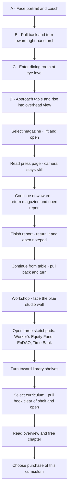

# Donte's house — camera and interaction storyboard

October 27, 2026 · Companion to [the researched build plan](build-plan.md)

The six supplied images are target views for one connected, painterly environment. The shot labels below define a route and its object interactions; they do not claim that the images establish a measured floor plan.

Every reader includes an independent return action. Room navigation also allows visitors to select a destination directly. Purchase requires an explicit choice.

**Tab travel:** Selecting any room tab now gives the visitor one uninterrupted 3D walk to that room. A Home-to-Library flight crosses the living-room arch and dining-room passage at eye level, passes the Workshop without pausing, then settles at the shelves. The reverse flight faces back toward Home. The overhead table shot and Workshop desk shot are endpoints only when their tabs are selected; they are not stops on a longer tab flight. Scroll navigation keeps the full narrated sequence with its stops and objects.

**Shell and reverse travel:** Treat the rooms as one enclosed home, with connected perimeter walls and a continuous ceiling where the camera reveals the shell. Set the perimeter behind the farthest camera position used by narrow-screen framing, or the camera can move outside the room. Preserve the open archways between rooms. Use one route-flight system in both directions so position and travel gaze stay coordinated; avoid separate hand-authored return gaze points that add a turn after the route has begun.

## A. Living room — the welcome

**Match:** central portrait, symmetrical recognition frames, indigo couch with orange trim, paired lamps, rug, painted texture.

**Hold:** let visitors orient and select a frame. Keep camera motion subtle until scrolling starts.

**Objects:** portrait → About; Forbes, Georgia Trend, Atlanta, Morehouse, Echoing Green → context and sources; Village → work/report destination.

**Transition:** pull back enough to reveal the doorway and establish a clear path around the furniture. Do not move forward into the couch or through the portrait wall.

## B. Reveal the arch — the spatial connection

**Match:** room volume, ceiling, wider couch view, right-hand carved arch, glimpse of the dining table.

**Movement:** camera moves back/right and turns to face the arch, then travels through its opening.

**Continuity:** the model keeps the personalized portrait and six plaques from Shot A; the generic painting in this wider reference does not replace them.

**Check:** camera clearance, consistent scale, rugs joining the room, adequate perspective coverage, and a comfortable turn on phones.

## C. Dining room — arrival

**Match:** indigo mural, warm cream walls and carved niches, hanging lantern, oval table, orange seats, plants, layered rugs.

**Movement:** enter at eye level, settle briefly, then travel toward the table. Rise and tilt downward to reach Shot D.

**Check:** the hanging light must not intersect the moving camera. Use its position to establish room depth, with a route that clears it.

## D and E. Table — three doors into the work

**Match:** oval indigo tabletop, left/center/right object layout, wood grain, warm seats, orange rug.

**Final object mapping:**

| Position | Site object | Opens |
| --- | --- | --- |
| Left publication | Donte's press magazine | `/press` |
| Center publication | Village ten-year report | `/work/ten-year-report` |
| Right notepad | Opportunities | `/connect` |

The supplied publication covers are composition references. Final covers need the actual press/report artwork. The tabletop must exist without printed-in publications so objects can lift away cleanly.

**Open gesture:** selected publication lifts, faces the camera, and opens around its spine. Camera approaches the paper. The open surface aligns with a readable HTML page and the URL changes without unloading the scene.

**Read:** the house freezes while the page scrolls. Press links open actual publication destinations.

**Finish:** a continued intentional scroll in the final continuation area reverses the opening motion, returns the object, and opens the next one. A labeled continuation control provides the same action for keyboard/touch. The sequence is magazine → report → notepad. At the notepad, form editing suspends progression.

**Check:** no duplicate magazine left in a background texture; no baked shadow remains after the real object moves; original camera/object positions restore correctly.

## F. Dining room to workshop — connecting shot

Author a short doorway/turn consistent with the house. First lower/pull the camera away from the tabletop, then turn into that opening. The newly supplied workshop reference supplies the intermediate view of the blue wall and desk; it does not define a measured floor plan. Preserve the dining mural and table view.

**Check:** the route should feel like movement through a connected interior. It should not rely on fading between unrelated still images.

## G. Workshop — new models under development

**Match:** square-on room composition, deep blue center, pale surrounding plaster, warm wood desk, chair, computer, layered plants, hanging lamps and the central framed artwork. The reference shows how the **wall and room should be built**; it is not itself the painting. Model the furnishings and wall in 3D. Crop only the central painting from the image for a wall-mounted texture. Put three individually selectable sketchpads on the modeled desk.

**Scroll story:** the camera approaches the Workshop without an early turn toward the shelves. Scrolling at the wall lifts the Worker’s Equity Fund sketchpad and opens a full-screen single sheet; continued scrolling reads it, opens EnDAO, then Time Bank, and finally moves toward the bookshelves. Scrolling up from the top of a pad returns it to the desk. Each pad also has a visible control, and the Workshop tab lands here; the Library tab is a direct shelf shortcut.

**Check:** no model claim is presented as a fully launched public product without support from source material. Verify the scene and text remain legible on phones.

## H. Library — books become learning

**Match:** frontal shelves, indigo wall, warm books and wood, plants, globe, rug, shafts of light, painted texture.

**Selectable shelf:** reserve a clearly composed band for Flourish Fellowship, AI, Blockchain, Cooperatives, Finance, and Funds. Keep decorative books in the surrounding collection.

**Open gesture:** selected curriculum slides straight clear of the shelf, rotates toward the camera, moves to its presentation position, and opens. Use the same matched paper-to-reader transition as the magazine.

**Reading destination:** curriculum explanation, contents, written free first chapter, sample resources, and purchase option. Paid chapters and downloads unlock only for that curriculum. Coming-soon books show their status and explanation.

**Exit:** “Return to shelf” closes the book and restores it to its exact slot. Arriving at the free chapter's purchase option holds the reader open; it does not auto-close the book or initiate checkout.

## Viewing and navigation rules

- House travel, object opening, and reading each have an explicit owner for the camera and scroll.
- A small room menu provides Living Room, Dining Room, and Library destinations.
- Object-to-reader motions are short timed transitions; room travel follows the visitor's scroll.
- Readers have their own shareable addresses, meaningful headings, and readable links.
- Reduced-motion and simpler-view presentations retain all content and purchase actions.
- Use separate portrait/landscape framing. The original square images are not a reason to hide off-screen objects on a narrow phone.

## First proof to review

With simple table geometry, demonstrate the magazine's lift/open, readable press page, end-of-page continuation, close/return, and report opening. This is the quality gate for the central interaction before producing the complete polished interior.
