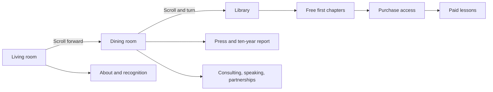

# Donte Miller — Personal website strategy

Revised October 27, 2026 · Three-room home concept

**Current implementation specification:** [Researched build plan](personal-website/build-plan.md), [visual camera storyboard](personal-website/camera-storyboard.md), and [reference manifest](personal-website/reference-manifest.csv). These expand this strategy with the supplied room images, seamless object-to-page transitions, the sequential dining-table experience, tools, access architecture, and acceptance checks.

## Confirmed direction

Create a personal platform that visitors explore as a connected home:

**Living room → dining room → library.**

The opening view faces a living-room wall and couch. Visitors scroll toward the dining room and its table, then the camera turns into the library. Objects are recognizable entry points into Donte's story, accomplishments, work, opportunities, and educational material.

Donte has supplied five visual references: Living Room, Transition to dining room, Dining Room, Dining Room Table, and Library. Unchanged copies are preserved in `personal-website/reference-images/`. Use them as the target compositions and art direction for connected room geometry and separately animated objects. Any additional images/video will be mapped to the relevant content. The earlier abstract sculpture and neighborhood studies are exploratory references; this room sequence is the current direction.

The platform represents Donte across existing work and future ventures. Village Micro Fund and EnDAO receive clear destinations within the home.

## Brand expressed through the home

The living room welcomes visitors and introduces the person. The dining room presents the work and invites conversation. The library shares knowledge and offers paid learning.

The connection to the founder context is strong: community, hospitality, education, and institution building are present in the experience itself. The communal table also connects naturally to the grandmother's kitchen story in `personal-journey.md`.

The supplied references establish a painterly home with rust-red and indigo surfaces, cream plaster, carved arches, warm wood, antique gold frames, patterned rugs, plants, and soft light. Preserve that character across the connected environment. The original portrait and award wall take precedence over generic artwork in the wider transition reference.

## Room one: living room / homepage

### Opening composition

Begin at human eye level, facing the couch and wall. Place the painting prominently above or near the couch and arrange recognition plaques within the opening view. Donte's name, a concise introduction, and an unobtrusive scroll cue should be readable immediately.

Keep the opening camera still until the visitor acts. Small pointer responses can add depth without making the room feel unstable. Use one clear cue such as “Explore the room” with labeled interactive objects.

### Objects and behavior

| Object | Content | Proposed interaction |
| --- | --- | --- |
| Painting | About Me | Select to bring the frame slightly forward, then open a readable biography with Donte's supplied images and video. |
| Forbes plaque | Forbes 30 Under 30 | Select for award context, year, and supporting profile link. |
| Atlanta plaque | Atlanta 500 | Select for recognition details and source. |
| Georgia Trend plaque | Georgia Trend 500 | Select for recognition details and source. |
| Echoing Green plaque | Echoing Green recognition | Select for fellowship/program details and source. |
| Morehouse frame | Morehouse College | Select for education and the role Morehouse played in Donte's journey. |

Use the supplied award artwork or a deliberate recreation with the approved wording. Finalize the exact labels and years from the source materials; the founder profile uses “Echoing Green Fellow,” while the user's outline says “Graduate.” Treat Morehouse's framed credential as an education item.

The About content can include a concise biography, personal origin story, selected milestones, and a portrait or introduction video. Let Donte choose how much personal history to include. Keep a direct link to About available independently of the painting.

## Transition: living room to dining room

After a comfortable viewing interval, scrolling moves the camera toward the dining room along a designed route. The visitor controls progress; scrolling backward retraces the route.

Set the furniture layout and doorway positions before building polished assets. The camera should pass through real openings with sufficient clearance, avoid furniture clipping, and arrive at a useful view of the dining table. Pause at the table long enough for its objects to be legible and selectable.

## Room two: dining room / work and opportunities

The dining table holds three primary objects. Their covers and shapes should distinguish them before a visitor selects one. Default guided sequence: magazine → ten-year report → opportunities notepad → library. At the end of a reader, continued intentional downward scrolling in its continuation area closes/returns the object and opens the next. Preserve direct selection, explicit return controls, and accessible continuation buttons. Suspend progression while a form is being edited.

| Object | Content | Proposed interaction |
| --- | --- | --- |
| Magazine | Press articles | Magazine lifts or opens; a readable press index shows article covers, publication names, dates, and links. |
| Ten-year report | Village Micro Fund and EnDAO | Report opens into an overview of the body of work, the supplied report, and clear links to Village and EnDAO. |
| Notepad | Consulting, speaking, partnerships | Notepad opens a short opportunity chooser and inquiry route with the selected interest already filled in. |

### Magazine

Start with the selected coverage in `press-media.md`, such as Forbes, ShoutOut Atlanta, and The Bitter Southerner. Add Donte's supplied assets and approved selections. Use excerpts and original summaries with links to the publications. Video features can open a normal player with captions where available and user-initiated sound.

### Ten-year report

Treat the report as a substantial object with its real cover and a clear reading destination. Provide a web summary and a download link if the supplied report supports that format. Separate “Explore Village Micro Fund” and “Explore EnDAO” actions so visitors understand both destinations.

Use the existing Village Micro Fund link from the founder context. Obtain the exact EnDAO destination from Donte or supplied assets before implementation; do not invent it. Distinguish historical outcomes, current activities, and projects in development.

### Notepad

Present three choices: Consulting, Speaking, Partnership. Each opens relevant details and a short inquiry form or email route. Gather only useful information: name, email, organization, interest, and message; allow optional timing and scope.

Write the actual service descriptions and speaking themes from Donte's preferences and existing expertise. Do not invent packages, pricing, availability, testimonials, or a scheduling link.

## Transition: dining room to library

Continued scrolling moves away from the table and turns into the library. The camera turn follows the visitor's scroll progress, with a gradual rotation and an intentional arrival facing the shelves.

Provide direct room navigation labeled **Living Room · Dining Room · Library**. Choosing a room moves to its viewing position; a motion-reduced setting changes directly between views. Closing an object returns the visitor to the same room and camera position.

## Room three: library / curricula

Use a shelf with clearly differentiated book spines and readable titles. Selecting a book brings its cover forward, then opens a useful course overview and chapter list.

| Book | Planned presentation | Access |
| --- | --- | --- |
| Flourish Fellowship | Curriculum overview, outcomes, chapter list, sample | First chapter free; remaining chapters paid |
| AI | Curriculum overview, outcomes, chapter list, sample | First chapter free; remaining chapters paid |
| Blockchain | Curriculum overview, outcomes, chapter list, sample | First chapter free; remaining chapters paid |
| Cooperatives | Clearly marked “Coming soon” | No purchase until released |
| Finance | Clearly marked “Coming soon” | No purchase until released |
| Funds | Clearly marked “Coming soon” | No purchase until released |

The first three are the intended course lineup, not a claim that their content is already complete. Confirm readiness when Donte supplies the materials. Coming-soon books may include a brief description; an interest list is optional and requires a real destination before launch.

### Learning and purchase experience

1. Select a book in the library or follow its direct link.
2. Read the course overview and see its format, intended audience, chapter list, and price once set.
3. Open the complete first chapter freely. Proposed default: no account required for the sample.
4. See the remaining chapters clearly identified as paid, with a purchase action for that specific curriculum.
5. Complete checkout for the selected curriculum and establish or link access to a learner account.
6. Return to the written lessons and associated downloadable resources. Returning learners can sign in directly and access the curricula they have purchased.

**Confirmed purchase model:** each curriculum is purchased separately. Purchasing one curriculum unlocks its remaining chapters and included downloadable resources. Each title has its own price, to be determined. The first chapter remains free.

**Confirmed delivery format:** written lessons with downloadable resources. Design the course reader around chapter navigation, comfortable typography, and clearly labeled resource downloads. Define the actual resource types from the supplied materials rather than assuming particular file formats.

The 3D book is the doorway; long-form learning takes place in a readable lesson view with clear chapter navigation. Each chapter can show its related downloads with a short description and file type. Materials attached to the free first chapter are available with the preview; paid chapter resources require purchase of that curriculum. On mobile, the course reader should use the screen fully. The learner account lists purchased curricula and provides a direct route to resume reading.

## Navigation and URLs

```text
Home (/)
├── Living room (/#living-room)
│   ├── About (/about)
│   └── Recognition (/recognition)
├── Dining room (/#dining-room)
│   ├── Press (/press)
│   ├── Ten-year report (/work/ten-year-report)
│   │   ├── Village Micro Fund (verified external destination)
│   │   └── EnDAO (destination to be supplied)
│   └── Opportunities (/connect)
└── Library (/library)
    ├── Flourish Fellowship (/library/flourish-fellowship)
    ├── AI (/library/ai)
    ├── Blockchain (/library/blockchain)
    ├── Coming-soon titles (within library until content warrants a page)
    └── Course chapters (/library/{course}/chapters/{chapter})
Account (/account)
```



| Destination | Primary route | Additional route |
| --- | --- | --- |
| About | Living-room painting | Text navigation / direct URL |
| Recognition | Wall plaques | About and footer links |
| Press | Dining-table magazine | Footer link |
| Report and project links | Dining-table report | About / direct URL |
| Opportunities | Dining-table notepad | Persistent Connect link |
| Library and course previews | Bookshelves | Persistent Library link |
| Purchased material | Course overview / account | Sign-in and account navigation |

Keep compact room navigation visible. Include Library, Connect, and Sign in through a readable menu rather than crowding the room view. Name/logo returns to the opening position. Footer links include press, verified profiles, project destinations, and appropriate purchase/privacy information. Course pages link to related projects or materials where useful; no essential destination depends solely on finding a 3D object.

Use unique addresses for readable destinations so visitors can share a course, article collection, or biography directly. Support browser Back and returning to the relevant room. Decide room query/hash synchronization during the camera prototype rather than mixing incompatible navigation schemes.

## Media intake

Donte will supply the images and video. Organize them by intended use:

- **Living room:** room/style references, painting artwork or portrait, About images/video, award/plaque images and years, Morehouse material.
- **Dining room:** magazine/article covers and links, ten-year report and cover, Village and EnDAO links, approved opportunity descriptions, optional supporting video.
- **Library:** course covers, descriptions, chapter outlines, written first chapters, remaining written lessons, and associated downloadable resources.
- **Overall:** preferred name/wordmark, portrait, any existing colors/type preferences, and atmosphere references.

Record intended placement, caption, title, source, and any crop or playback preferences. Preserve originals and derive optimized versions for the website. Images and video can supply artwork, textures, and embedded content; the room layout, furniture geometry, lighting, and camera route still need to be authored or sourced as 3D assets.

## Implementation approach

Use Three.js with React Three Fiber for a connected home environment, with three intentional camera stops. Prototype furniture as simple geometry first. Use web-ready models and optimized textures for the final room; develop the path around the final layout.

Build the content destinations as conventional HTML pages or panels linked to real URLs. Decouple media, press records, project destinations, opportunity choices, and curricula from the 3D objects so updates do not require changing the scene model.

Drei's scroll controls expose scroll progress for coordinating camera and scene behavior. Prototype the desired movement and direct-room navigation together; choose the specific scroll integration based on those tests. Source: [Drei ScrollControls](https://drei.docs.pmnd.rs/controls/scroll-controls).

For paid learning, add authentication, a payment provider, and server-side purchase entitlements for each curriculum. Keep paid lesson content and resource downloads protected on the server; hiding a chapter button is insufficient. Confirm payment through verified provider events and make fulfillment safe to retry. A purchase must grant access to the selected curriculum without unlocking other titles. Handle returning learners, duplicate events, refunds, and delayed payments before launch. Stripe Checkout is a candidate to evaluate, with fulfillment following its official documentation: [Stripe post-payment events](https://docs.stripe.com/payments/existing-customers?platform=web&ui=stripe-hosted).

The purchase model is confirmed as separate curriculum purchases. Payment provider, hosting vendor, individual prices, and access duration remain to be decided.

## Accessibility and device behavior

Use labeled objects with clear hover, focus, and tap states. Give the same destinations ordinary links. Support keyboard selection, close controls, readable text, and focus return after closing a panel. Stop room scrolling while a reader or form is active.

Use a simplified mobile presentation with deliberate camera framing, large interaction targets, and readable labels. Respect reduced-motion preferences with still room views and direct transitions. Provide static room images with the same content links when 3D is unavailable. Let visitors choose video playback and sound. Load and prioritize assets so the opening introduction is available while later-room assets prepare.

## Build sequence and review gates

1. **Asset and content intake.** Map supplied images/video to the three rooms, inventory written lessons and downloads for each separately sold curriculum, and finalize destinations and recognition wording.
2. **Spatial prototype.** Build the living-room wall/couch, dining table, and bookshelves as simple geometry. Establish the scroll-forward path and library turn. Review all three camera stops and reverse navigation before detailed modeling.
3. **Object interactions.** Implement painting, plaques, magazine, report, notepad, and books. Connect each to a readable destination. Verify close/back behavior, room navigation, keyboard use, and mobile access.
4. **Art and media pass.** Apply supplied imagery, authored furniture/assets, lighting, materials, and restrained animation. Optimize loading and rendering on representative phones and computers.
5. **Learning and commerce.** Publish complete free first chapters, build the written lesson reader and resource downloads, integrate accounts and checkout for separate curriculum purchases, and protect paid access. Add returning-learner behavior and coming-soon states.
6. **Final verification and launch preparation.** Check all room paths, project links, forms, media, account access, payment outcomes, and fallback views. Review a finished preview before publication.

This is a larger scope than the earlier single-sculpture concept. Re-estimate after reviewing assets, curriculum readiness, and the spatial prototype. Treat room production and learning/commerce as separate workstreams within the same release plan; do not reuse the earlier 4–6 week estimate as a commitment.

## Completion criteria

- Opening view faces the requested couch/wall arrangement.
- Every specified living-room object leads to the intended content.
- Scrolling reaches the dining room, and continued progress turns into the library; reverse movement and direct room navigation work.
- Magazine, ten-year report, and notepad each have distinct, working destinations.
- Library contains all six named topics with clear available/coming-soon states.
- Every released curriculum has a complete free first chapter, written lessons, and the associated downloadable resources.
- Each curriculum is sold separately; confirmed purchases unlock that curriculum's paid chapters and resources and work for returning learners.
- Essential content remains reachable with keyboard, on mobile, with reduced motion, and without the 3D scene.

## Immediate next step

The [camera storyboard](personal-website/camera-storyboard.md) now maps the supplied visuals. Build the defining interaction first using simple geometry: table → magazine lift/open → readable press page → continued-scroll return → report opening. Prove this on desktop and mobile before producing the complete polished environment. See the [build plan](personal-website/build-plan.md) for tool choices, implementation phases, and quality gates.
